<picture>
  <source media="(prefers-color-scheme: dark)" srcset="https://raw.githubusercontent.com/qzh200/qzh200/gitascii/profiles/default/dark.svg">
  <source media="(prefers-color-scheme: light)" srcset="https://raw.githubusercontent.com/qzh200/qzh200/gitascii/profiles/default/light.svg">
  
</picture>
<!-- GITASCII:TELEMETRY:START - Measures badge fetches (usually GitHub Camo refreshes), not exact human views -->

<!-- GITASCII:TELEMETRY:END -->
