<!-- GITASCII:two:START -->
<picture>
  <source media="(prefers-color-scheme: dark)" srcset="https://raw.githubusercontent.com/qzh200/qzh200/gitascii/profiles/two/dark.svg">
  <source media="(prefers-color-scheme: light)" srcset="https://raw.githubusercontent.com/qzh200/qzh200/gitascii/profiles/two/light.svg">
  
</picture>
